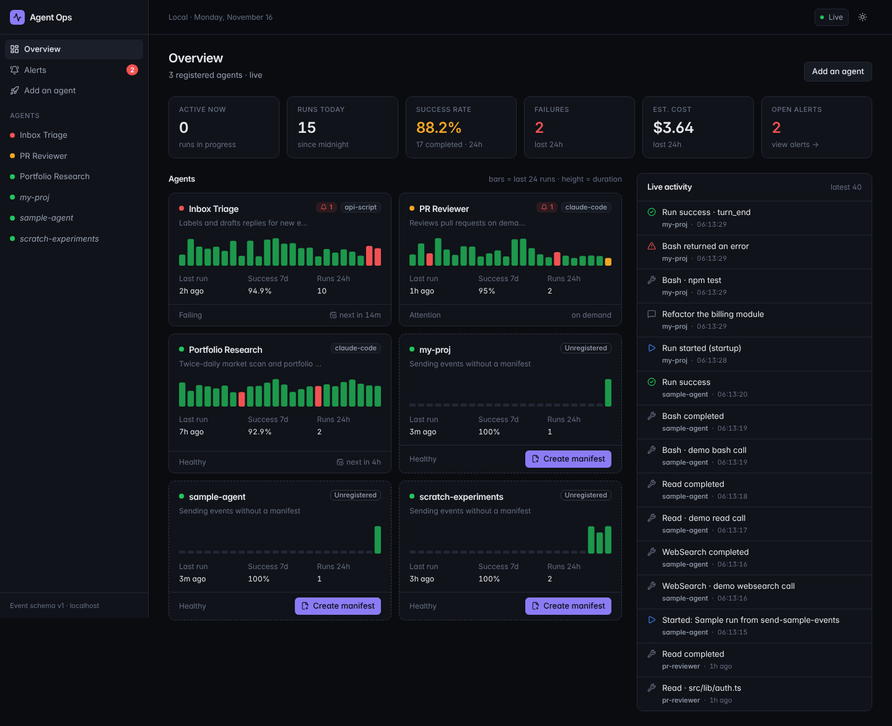

# Agent Ops

A local, professional dashboard for monitoring AI agent workflows. Today it watches your Claude Code sessions; it's built so any future agent can join by adding one YAML file and a few lines of reporting.



## Quick start

```bash
npm install
npm run seed      # optional: 3 demo agents with two weeks of runs
npm run dev       # → http://localhost:4321
```

Then open **Add an agent** (`/onboarding`) to connect a real Claude Code project. For production mode, run `npm run build && npm start`.

Requirements: Node 20 or newer. Everything is local: SQLite (`data/agent-ops.db`) and no external services.

## What you get

| Screen | What it shows |
|---|---|
| **Overview** | Headline numbers (active now, runs today, success rate, failures, est. cost, open alerts), a card per agent with a status strip of its last 24 runs, and a live activity feed. |
| **Agent** | Runs per day, average duration and cost charts, run history, alert rules, the manifest and recent activity. |
| **Run** | Full event timeline (prompts, tool calls, results, errors); click any event to see its JSON. |
| **Alerts** | Open, acknowledged and resolved alerts with actions. Alerts auto-resolve when the condition clears. |
| **Add an agent** | A step-by-step guide with copy-paste snippets, live "listening for events" status and one-click manifests. |

Updates arrive in real time over Server-Sent Events. A dark theme is the default, and a light theme is one click away.

## How it works

```
 Claude Code ──hook.mjs──┐
 Python / TS scripts ────┼──► POST /api/events ──► SQLite (runs · events · alerts)
 anything that can POST ─┘          │                       │
                                    ├─► alert engine ◄──── agents/*.yaml (registry, hot-reloaded)
                                    └─► SSE /api/stream ──► dashboard re-renders live
```

- **Registry** (`agents/*.yaml`): each agent is a manifest with name, type, schedule, tags and alert rules, checked by a Zod schema. Add a file and the agent appears; break a file and the error appears in the UI. Events from unknown agents still show up, marked *Unregistered*, with a **Create manifest** button.
- **Event contract** (`docs/EVENT_SCHEMA.md`): versioned (v1) and add-only. Supports batches, duplicate-safe `event_id`s, and delta or cumulative metrics.
- **Alert rules:** `consecutive_failures`, `failures_in_window`, `runtime_exceeds`, `no_run_within`, `cost_per_run_exceeds`. They're checked on every event and every 60s.

## Claude Code integration

```bash
npm run hook-config              # prints a .claude/settings.json hooks block with the right path
npm run import:transcripts       # backfill history from ~/.claude/projects (safe to re-run)
```

The hook maps `SessionStart`, `UserPromptSubmit`, `PreToolUse`, `PostToolUse`, `Notification`, `SubagentStop`, `Stop` and `SessionEnd` to events. On `Stop` it reads the transcript for token usage and estimated cost. It is fire-and-forget: 1s timeout, no output, always exits 0. One session is one run.

### Cloud sessions (claude.ai/code)

Cloud sessions run in a remote container and **can't reach `localhost`**. The first version covers local sessions. To include cloud sessions later, either:

1. Expose the dashboard through a tunnel (e.g. Cloudflare Tunnel or ngrok) and set `AGENT_OPS_URL=https://your-tunnel` for the hook, adding that host to the cloud environment's network allowlist; or
2. Host the dashboard (e.g. a small VM, or Vercel with a hosted database) and point `AGENT_OPS_URL` at it.

Before exposing the dashboard beyond localhost, put authentication in front of it (for example a tunnel with access control). The ingest API has no auth because it's designed for localhost.

## Scripts

| Command | Purpose |
|---|---|
| `npm run dev` / `npm start` | Run the dashboard on :4321 |
| `npm test` | Unit tests (manifest validation, ingestion, alert rules, hook, importer) |
| `npm run typecheck` | TypeScript check |
| `npm run seed` | Demo data (`--reset` to regenerate, `--remove` to delete demo agents) |
| `npm run send-sample-events [agent-id]` | End-to-end check of the HTTP API against a running dashboard |
| `npm run hook-config [agent-id]` | Print the Claude Code hooks block |
| `npm run import:transcripts` | Backfill Claude Code history (`--since 7`, `--project name`, `--agent id`, `--dir path`) |

Environment variables: `AGENT_OPS_DB` (database path), `AGENT_OPS_AGENTS_DIR` (manifest folder), and for the hook `AGENT_OPS_URL`, `AGENT_ID`, `AGENT_OPS_DEBUG`.

## Project layout

```
agents/                    agent manifests (the registry)
docs/                      EVENT_SCHEMA.md, ONBOARDING.md
integrations/claude-code/  hook.mjs + example settings
scripts/                   seed, import-transcripts, send-sample-events, print-hook-config
src/lib/                   data layer: db/, registry/, events/, alerts/, queries.ts, importer.ts
src/components/            UI: ui/ primitives + presentational components
src/app/                   pages (server components) and api/ routes
tests/                     vitest unit tests
```

## Restyling

All colours, radii, shadows and fonts are design tokens in `src/app/globals.css`, with light and dark sets. Components only use token utilities (`bg-surface`, `text-fg-muted`, `text-status-failed`…), so a visual refresh shouldn't need to touch any data or logic code.
